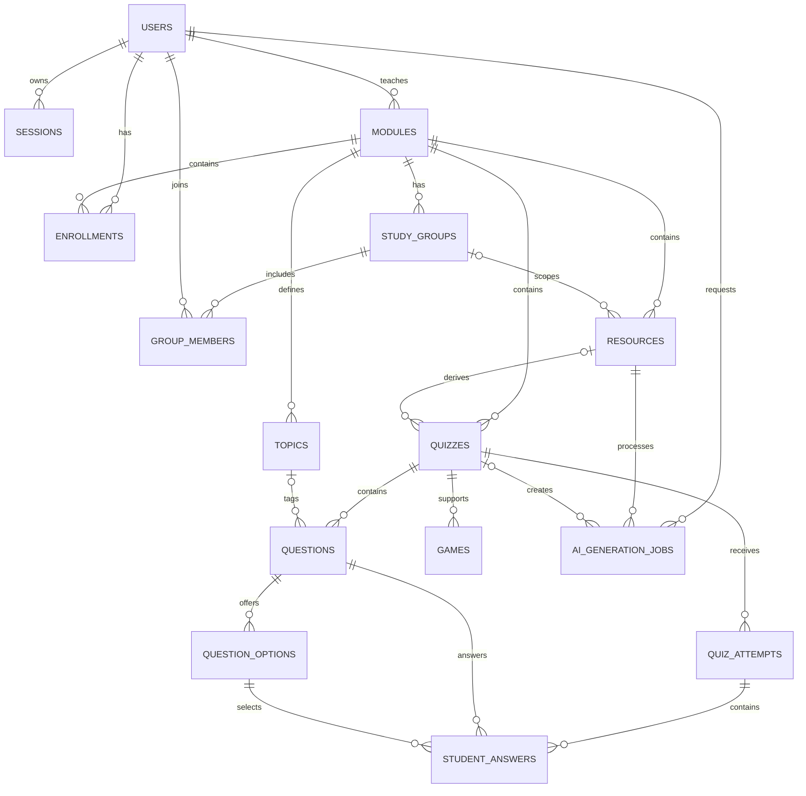

# EduQuest ERD

The Milestone 1 schema is implemented in `db/migrations/002_schema.sql` and constrained in `db/migrations/003_invariants.sql`.

Games are practice-only and reuse quiz questions. They do not create leaderboard records.
