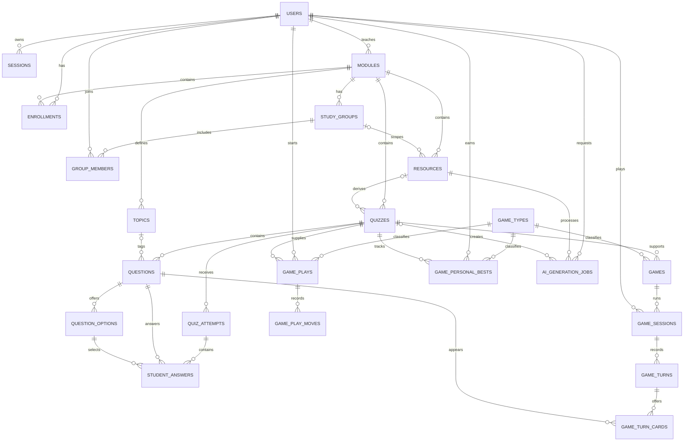

# EduQuest ERD

The Milestone 1 schema is implemented in `db/migrations/002_schema.sql` and constrained in `db/migrations/003_invariants.sql`.

`game_types` is a data-driven catalog (`GameTypeID`, unique `Key`, `DisplayName`, `IsEnabled`). `games.GameTypeID` references it. `infected`, `island_escape`, `memory_match`, and `boss_battle` are enabled; `flashcards`, `timer_trivia`, and `pixel_racer` are disabled until their implementation gates pass. The superseded `speed_round` and `match_pairs` rows are removed. Games are practice-only and reuse quiz questions; they do not create leaderboard records.

Questions use required `DifficultyLevel smallint` (1–5, default 3) and nullable `Explanation` (1–300 characters). The shared mapping is levels 1–2 Easy, 3 Medium, and 4–5 Hard.

- `game_sessions(SessionID PK, GameID FK, StudentID FK, Mode, Cure, Hearts, Score, Status, CreatedAt, UpdatedAt, CompletedAt)` stores practice-only state. A partial unique index permits one in-progress solo session per game/user.
- `game_turns(TurnID PK, SessionID FK, TurnNumber, ChosenQuestionID FK, ChosenOptionID FK, IsCorrect, CureBefore, CureAfter, HeartsBefore, HeartsAfter, ScoreDelta, CreatedAt, AnsweredAt)` records an immutable answered transition.
- `game_turn_cards(TurnID FK, SessionID FK, CardIndex, QuestionID FK, DifficultyLevel)` records offered cards. `(TurnID, CardIndex)` is the primary key and `(SessionID, QuestionID)` is unique.
- Composite foreign keys enforce that the chosen question was offered and the chosen option belongs to it. Triggers enforce quiz scope, stored difficulty, one-heart wrong-answer loss, and answer-once behavior.

Generic solo-game storage introduced by migration 007:

- `game_plays(PlayID PK, GameTypeID FK, StudentID FK, QuizID FK, Mode, Status, State jsonb, Score, CreatedAt, UpdatedAt, CompletedAt)` stores versioned game-owned state. A partial unique index permits one in-progress solo play per game type, user, and quiz.
- `game_play_moves(MoveID PK, PlayID FK, MoveNumber, MoveType, Payload jsonb, StateAfter jsonb, QuestionID FK nullable, OptionID FK nullable, PhaseAttempt nullable, CreatedAt)` is append-only and uniquely ordered within a play. Island Escape uses the question, option, and phase-attempt columns to enforce answer scope and no repeated question within an attempt.
- Checks require object-shaped versioned state and non-negative scores. Triggers enforce module scope, append-only moves, and terminal-state finality.
- `game_personal_bests(GameTypeID FK, StudentID FK, QuizID FK, Score, UpdatedAt)` stores practice-only personal records; its composite key is `(GameTypeID, StudentID, QuizID)`.

Memory Match uses `game_plays` for its versioned, Zod-validated shuffled-card state and `game_play_moves` for its append-only flip log. The partial unique index resumes the same in-progress play for a student, game type, and quiz. Pair identity and all unflipped text remain server-only; persisted client state uses opaque card IDs, kinds, face state, matched state, score, moves, and mismatch count.

Boss Battle uses the same generic tables with a versioned state containing bounded boss/player HP, score, a server-shuffled remaining-question queue, the current question, and terminal status. Each answer appends one immutable move and the play row stores the latest validated state; terminal-state and append-only triggers remain shared with the other generic games.
