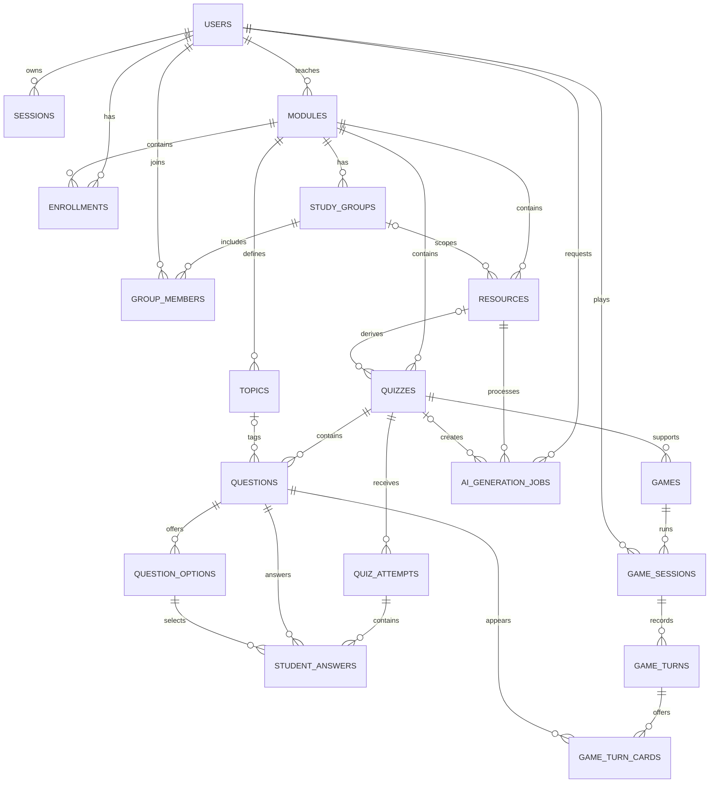

# EduQuest ERD

The Milestone 1 schema is implemented in `db/migrations/002_schema.sql` and constrained in `db/migrations/003_invariants.sql`.

`game_types` is a data-driven catalog (`GameTypeID`, unique `Key`, `DisplayName`, `IsEnabled`). `games.GameTypeID` references it. The seeded keys `flashcards`, `speed_round`, and `match_pairs` are disabled placeholders; `infected` is enabled. Games are practice-only and reuse quiz questions; they do not create leaderboard records.

Infected extends `questions` with required `Difficulty` (`easy|medium|hard`, default `medium`) and nullable `Explanation` (1–300 characters).

- `game_sessions(SessionID PK, GameID FK, StudentID FK, Mode, Cure, Hearts, Score, Status, CreatedAt, UpdatedAt, CompletedAt)` stores practice-only state. A partial unique index permits one in-progress solo session per game/user.
- `game_turns(TurnID PK, SessionID FK, TurnNumber, ChosenQuestionID FK, ChosenOptionID FK, IsCorrect, CureBefore, CureAfter, HeartsBefore, HeartsAfter, ScoreDelta, CreatedAt, AnsweredAt)` records an immutable answered transition.
- `game_turn_cards(TurnID FK, SessionID FK, CardIndex, QuestionID FK, Difficulty)` records offered cards. `(TurnID, CardIndex)` is the primary key and `(SessionID, QuestionID)` is unique.
- Composite foreign keys enforce that the chosen question was offered and the chosen option belongs to it. Triggers enforce quiz scope, stored difficulty, one-heart wrong-answer loss, and answer-once behavior.
