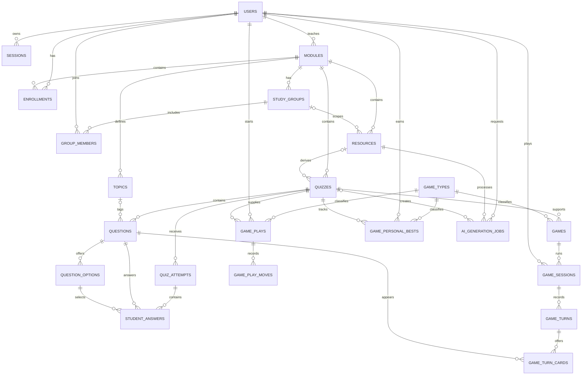
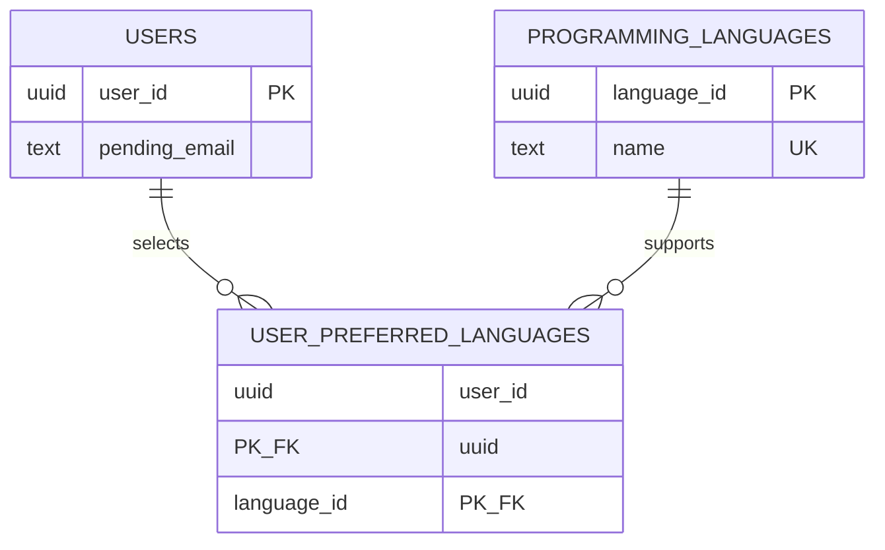
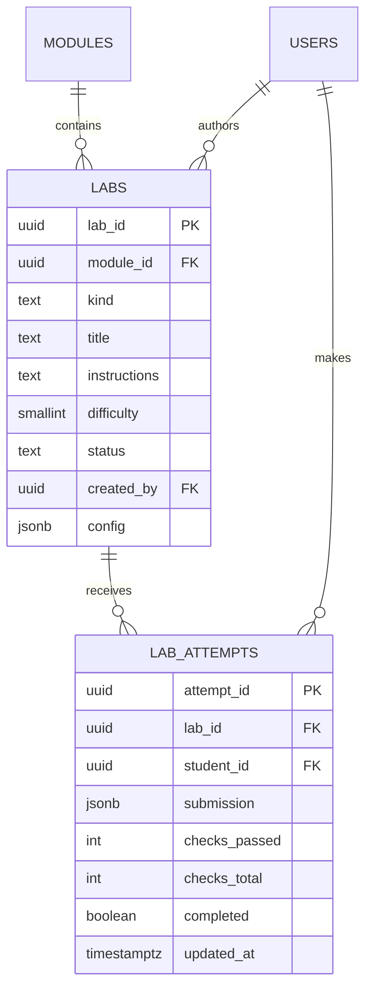
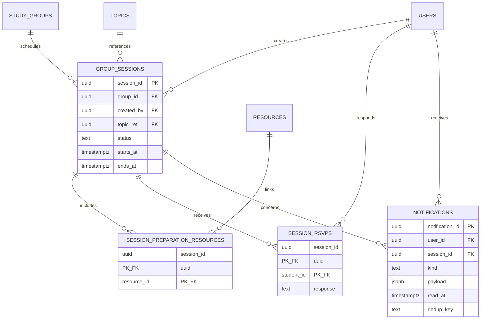
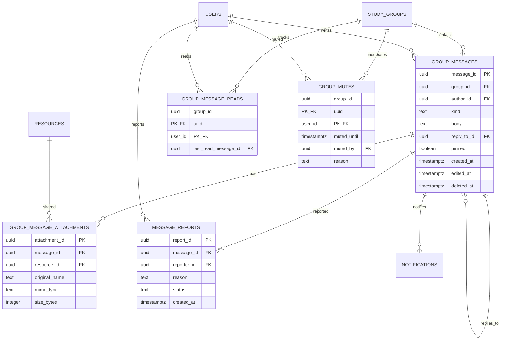

# EduQuest ERD

The Milestone 1 schema is implemented in `db/migrations/002_schema.sql` and constrained in `db/migrations/003_invariants.sql`.

`game_types` is a data-driven catalog (`GameTypeID`, unique `Key`, `DisplayName`, `IsEnabled`). `games.GameTypeID` references it. `infected`, `island_escape`, `memory_match`, `boss_battle`, `pixel_racer`, and `timer_trivia` are enabled; `flashcards` remains disabled. The superseded `speed_round` and `match_pairs` rows are removed. Games are practice-only and reuse quiz questions; they do not create leaderboard records.

Questions use required `DifficultyLevel smallint` (1–5, default 3) and nullable `Explanation` (1–300 characters). The shared mapping is levels 1–2 Easy, 3 Medium, and 4–5 Hard.

- `game_sessions(SessionID PK, GameID FK, StudentID FK, Mode, Cure, Hearts, Score, Status, CreatedAt, UpdatedAt, CompletedAt)` stores practice-only state. A partial unique index permits one in-progress solo session per game/user.
- `game_turns(TurnID PK, SessionID FK, TurnNumber, ChosenQuestionID FK, ChosenOptionID FK, IsCorrect, CureBefore, CureAfter, HeartsBefore, HeartsAfter, ScoreDelta, CreatedAt, AnsweredAt)` records an immutable answered transition.
- `game_turn_cards(TurnID FK, SessionID FK, CardIndex, QuestionID FK, DifficultyLevel)` records offered cards. `(TurnID, CardIndex)` is the primary key and `(SessionID, QuestionID)` is unique.
- Composite foreign keys enforce that the chosen question was offered and the chosen option belongs to it. Triggers enforce quiz scope, stored difficulty, one-heart wrong-answer loss, and answer-once behavior.

Generic solo-game storage introduced by migration 007:

- `game_plays(PlayID PK, GameTypeID FK, StudentID FK, QuizID FK, Mode, Status, State jsonb, Score, CreatedAt, UpdatedAt, CompletedAt)` stores versioned game-owned state. A partial unique index permits one in-progress solo play per game type, user, and quiz.
- `game_play_moves(MoveID PK, PlayID FK, MoveNumber, MoveType, Payload jsonb, StateAfter jsonb, QuestionID FK nullable, OptionID FK nullable, PhaseAttempt nullable, CreatedAt)` is append-only and uniquely ordered within a play. Island Escape uses the question, option, and phase-attempt columns to enforce answer scope and no repeated question within an attempt.
- Checks require object-shaped versioned state and non-negative scores. Triggers enforce module scope, append-only moves, and terminal-state finality.
- `game_personal_bests(GameTypeID FK, StudentID FK, QuizID FK, Score, UpdatedAt)` stores practice-only personal records; its composite key is `(GameTypeID, StudentID, QuizID)`.

Memory Match uses `game_plays` for its versioned, Zod-validated shuffled-card state and `game_play_moves` for its append-only flip log. The partial unique index resumes the same in-progress play for a student, game type, and quiz. Pair identity and all unflipped text remain server-only; persisted client state uses opaque card IDs, kinds, face state, matched state, score, moves, and mismatch count.

Boss Battle uses the same generic tables with a versioned state containing bounded boss/player HP, score, a server-shuffled remaining-question queue, the current question, and terminal status. Each answer appends one immutable move and the play row stores the latest validated state; terminal-state and append-only triggers remain shared with the other generic games.

Pixel Car Racer uses the generic tables with versioned player and deterministic-Bot race state: bounded speed, distance, streak, points, nitro state, consumed slots, a shared server-selected question list, and terminal outcome. Each server-scored answer appends one immutable move. Race scores remain practice-only and are not queried by leaderboard or scored analytics services.

Timer Trivia uses the generic tables with a versioned topic/level board state, up to five topic columns, point rows 10–50 mapped to levels 1–5, server deadlines, answered-cell tracking, and terminal status. A user’s `extended_time` preference doubles the server deadline. The server selects each distinct question cell, owns timeout and scoring decisions, and practice results remain outside leaderboards and scored analytics.
The final identity schema also includes `users.FirstName`, nullable `users.LastName`, `users.StudentType`, `users.EmailVerifiedAt`, `email_verification_tokens`, `mfa_credentials`, and `mfa_recovery_codes` from migration 016. MFA tables are storage scaffolding only until the MFA API slice is implemented.

### Profile additions

### Module catalogue additions

`USERS.StudentYear` is nullable for lecturers and required 1–3 for students. `MODULES.Year` is 1–3, `MODULES.Programme` is `it|business|both`, `MODULES.Offering` is a non-empty offering label, and `MODULES.Description` is bounded text. The enrolled-module and resource-tile endpoints project only owner/enrollment-visible data. The look-ahead endpoint projects year-2 module metadata and topic/prerequisite hints only; it does not return resources, quizzes, answers or enrolment actions.
Study-group collaboration adds `GROUP_LANGUAGES(GroupID, LanguageID)`, `GROUP_LEADERS(GroupID, StudentID, Role)`, and `GROUP_UPDATES(UpdateID, GroupID, AuthorID, Kind, Text, TopicID, PlannedFor, CreatedAt)`. `STUDY_GROUPS` now also has `Focus`, `Description`, and `Visibility`. A database trigger prevents removing or demoting the last leader.

### Practice Labs

`LABS` stores lecturer-owned, module-scoped practice activities and kind-specific JSON configuration. `LAB_ATTEMPTS` stores one student-owned draft/progress record per lab. Submission checks are explicitly self-checked in the browser; these rows are not scored quiz attempts and are excluded from leaderboards and analytics.

For `spreadsheet` labs, `config` contains bounded starting cells, locked-cell addresses, tolerance checks and display formats. `calculator` configs contain declarative inputs and output formulas; `scenario` configs contain finite nodes, choices and meter changes. None of these configurations is executable code.

### Manual quiz authoring additions

`questions` now stores `question_type`, `accepted_answers`, `ignore_punctuation`, bounded code display fields and `display_order`. `student_answers.option_id` is nullable when a short-answer response is stored in `answer_text`; the check constraint requires one of those answer forms. Authoring routes remain owned by the lecturer who owns the quiz module.

### Study session additions

### Study group messaging additions

