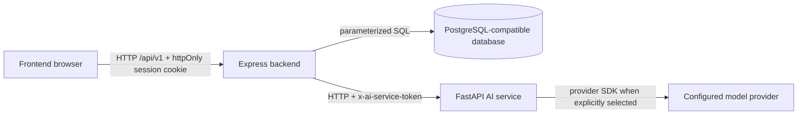

# EduQuest Architecture Layers

## Presentation

- `frontend/src/main.jsx`: React screens, route selection, forms, game views and API calls.
- `frontend/src/styles.css`: palette, typography, responsive layout and accessibility states.
- `frontend/e2e/`: Playwright viewport and axe flows.

## Application logic

- `backend/src/app.js`: Express routes, authentication, RBAC, validation, quiz engine, leaderboard and analytics endpoints.
- `backend/src/profanity/`: shared server-side text policy.
- `backend/src/games/*/engine.js`: pure authoritative engines for Infected, Island Escape, Memory Match, Boss Battle, Pixel Car Racer and Timer Trivia.
- `backend/src/games/*/routes.js`: persistence, authorization and response shaping for each game.
- `backend/src/games/*/state.js`: versioned Zod state schemas and registry entries.

## Data access

- `backend/db.js`: parameterized `pg` pool.
- `db/migrations/`: ordered schema, constraints, indexes and triggers.
- `backend/scripts/migrate.js` and `backend/scripts/reset-test-db.js`: migration and repeatable test-database lifecycle.

## AI service

- `ai-service/app.py`: FastAPI request schemas, shared-secret middleware, timeout/body limits and provider selection.
- `ai-service/run.py`: localhost-bound service startup guard.
- `backend/scripts/ai-worker.js`: queued job worker; the backend is the only component that calls the AI service.

## Communication

The frontend never calls the AI service directly. The backend supplies the shared-secret header and validates every AI response before persistence.
